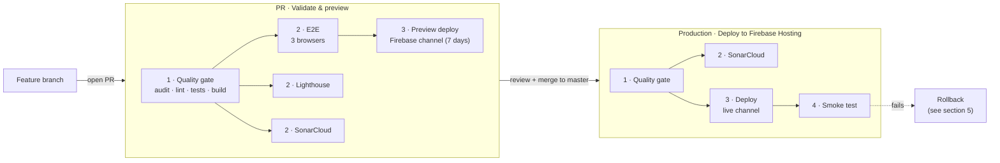

# Deployment strategy

How code goes from a branch to **https://www.concursohomebrewercordoba.es/**, and how to roll back.

The site is a static Angular build (every route prerendered to HTML) hosted on **Firebase Hosting**, project `concursohomebrewercordob-6d540`. There is no server and no database, so a deployment is just "upload a new `dist/` folder". Firebase keeps every previous upload, which is what makes rollbacks instant.

---

## 1. Summary

| | |
|---|---|
| **Branching model** | Trunk-based. `master` is always deployable; all work happens in short-lived branches merged through pull requests. |
| **Environments** | `preview` (one temporary Firebase channel per PR) → `production` (Firebase `live` channel). |
| **Promotion** | Automatic. Merging a PR into `master` deploys it to production. |
| **Gate** | A PR needs 1 approving review (branch protection) and should be green on all PR checks before merging. |
| **Build once** | Each pipeline builds `dist/` a single time; tests, previews and the deploy all use that same artifact. |
| **Serialized releases** | Only one production deploy runs at a time (`concurrency: production-deploy`). |
| **Verification** | After every production deploy, a smoke test requests the key pages of the live site. |
| **Rollback** | Firebase console (instant) or re-run the production workflow on the last good commit. |



---

## 2. Workflows

All workflows live in [`.github/workflows/`](../.github/workflows). Job names are numbered by stage, so the order is clear in the GitHub Actions UI.

### `quality-gate.yml` — Quality gate (reusable)

Not triggered directly: both pipelines below call it as their first stage, so PRs and production apply exactly the same checks.

1. `npm ci`
2. `npm audit --omit=dev --audit-level=high` (fails on high or critical vulnerabilities in runtime dependencies)
3. `npm run lint`
4. Unit tests with coverage (Vitest)
5. Production build (`npm run build`, enforces the bundle budgets in `angular.json`)
6. Uploads the `dist` and `coverage` artifacts for the next stages

It accepts an optional `ref` input so the production pipeline can build an older commit for a rollback.

### `pull-request.yml` — PR · Validate & preview

**Trigger:** every pull request targeting `master` (a new push cancels the previous run of the same PR).

| Job | What it does | Blocks the preview? |
|---|---|---|
| `1 · Quality gate` | The reusable gate above | yes |
| `2 · E2E tests (Chromium, Firefox, WebKit)` | Playwright smoke tests against the built `dist/` | yes |
| `2 · Lighthouse audit` | Accessibility and SEO must score ≥ 0.9 (error); performance and best practices are warnings | no |
| `2 · SonarCloud analysis` | Code quality and coverage, decorates the PR | no |
| `3 · Deploy preview (Firebase channel, 7 days)` | Uploads the build to a temporary channel and comments its URL on the PR | — |

The preview is a real copy of the site at a temporary URL (shown on the PR and under the `preview` environment), so reviewers can check the change before it goes live. It expires after 7 days. PRs from forks skip SonarCloud and the preview because repository secrets are not available to them.

### `deploy-production.yml` — Production · Deploy to Firebase Hosting

**Triggers:**
- every push to `master` (that is, every merged PR);
- manually from *Actions → Production · Deploy to Firebase Hosting → Run workflow*, with an optional `ref` (commit SHA, tag or branch) to redeploy or roll back.

| Job | What it does |
|---|---|
| `1 · Quality gate` | The reusable gate, on the commit being released |
| `2 · SonarCloud analysis (master)` | Updates the `master` analysis (push only, does not block the deploy) |
| `3 · Deploy to production (live channel)` | Uploads the gate's `dist` artifact to the Firebase `live` channel. Recorded as a deployment of the `production` environment |
| `4 · Smoke test production` | Requests `/`, `/rules`, `/awards` and `/registration` on the live domain, with retries |

If the quality gate fails, nothing is deployed and the live site stays as it was.

---

## 3. Environments and secrets

| GitHub environment | Firebase target | URL |
|---|---|---|
| `preview` | channel `pr-<number>-<branch>` (expires in 7 days) | shown on each PR |
| `production` | channel `live` | https://www.concursohomebrewercordoba.es/ |

GitHub creates the environments automatically on first use. The *Environments* page and the *Deployments* list on the repo home show which commit is currently live and the full history.

Repository secrets used:

| Secret | Used by |
|---|---|
| `FIREBASE_SERVICE_ACCOUNT_CONCURSOHOMEBREWERCORDOB_6D540` | preview and production deploys |
| `SONAR_TOKEN` | SonarCloud jobs (skipped if empty) |

`FIREBASE_TOKEN_LIVE` and `CHANNEL_ID` are leftovers from the old token-based deploy and are no longer referenced.

**Optional hardening** (repo *Settings → Environments → production*):
- *Deployment branches and tags → Selected*: allow only `master` (plus tags if you deploy tags).
- *Required reviewers*: add yourself if you want to approve each release manually instead of deploying on every merge.

---

## 4. Day-to-day release flow

1. Create a branch from `master` (convention: `<year>/<Short_description>`, e.g. `2026/Add_logos`).
2. Push and open a PR. Wait for the checks to go green and open the preview link from the PR comment.
3. Get the PR approved and merge it.
4. Watch *Actions → Production · Deploy to Firebase Hosting*. When `4 · Smoke test production` is green, the release is live.

Annual edition changes (dates, prizes, sponsors) follow the same flow. Dates live in `src/app/shared/global-constants.ts`.

---

## 5. Rollback

Pick whichever is faster:

**A. Firebase console (instant, no build).** Firebase console → Hosting → *Release history* → choose the last good release → *Roll back*. Use this when production is broken right now.

**B. Redeploy a known good commit.** *Actions → Production · Deploy to Firebase Hosting → Run workflow*, with `ref` set to the last good commit SHA (from the *Deployments* list or `git log`). This runs the full gate on that commit and redeploys it.

After either option, fix the problem on a branch and merge it normally. The next merge to `master` deploys again on top of the rollback.

**C. Revert.** `git revert <bad commit>` in a PR. This is the clean long-term fix, because it keeps `master` and production in sync.

---

## 6. Manual deploy (emergency only)

Requires the [Firebase CLI](https://firebase.google.com/docs/cli) and access to the project:

```sh
npm ci
npm run build
firebase deploy --only hosting --project concursohomebrewercordob-6d540
```

This skips every check and is not recorded in GitHub's deployment history. Prefer option 5B.

---

## 7. Dependency updates

Dependabot ([`.github/dependabot.yml`](../.github/dependabot.yml)) opens PRs every Monday: Angular packages grouped, dev dependencies grouped (minor and patch), and GitHub Actions. They go through the same PR pipeline as any other change.

If `npm audit` blocks the gate on a transitive dependency without an upstream fix, pin a patched version under `overrides` in `package.json` (currently `vite`, which `@angular/build` pins to a vulnerable 8.3.0).
